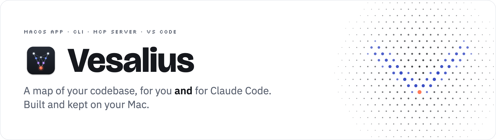
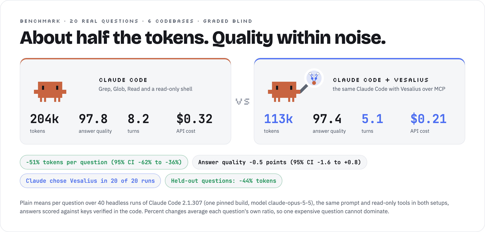
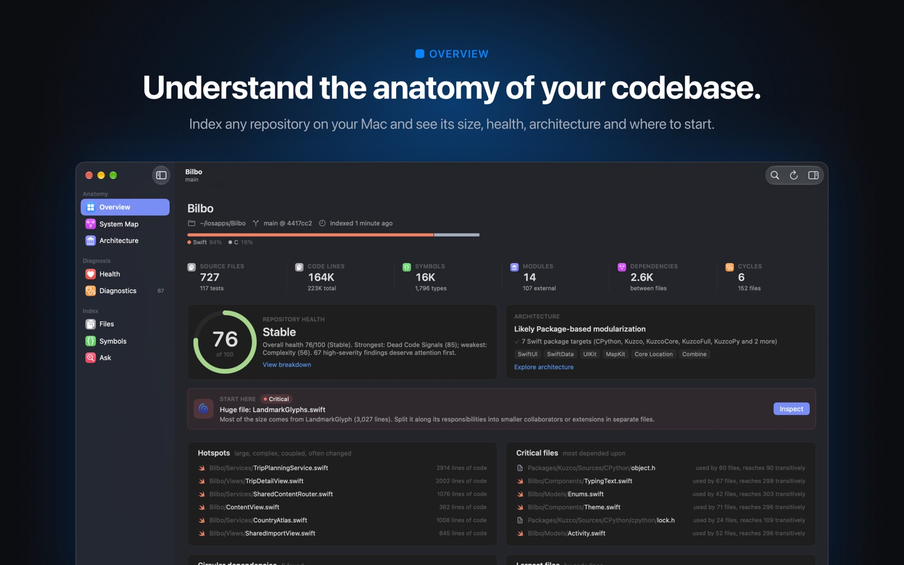
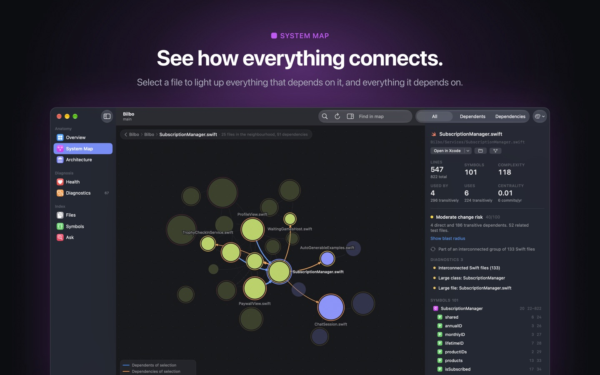
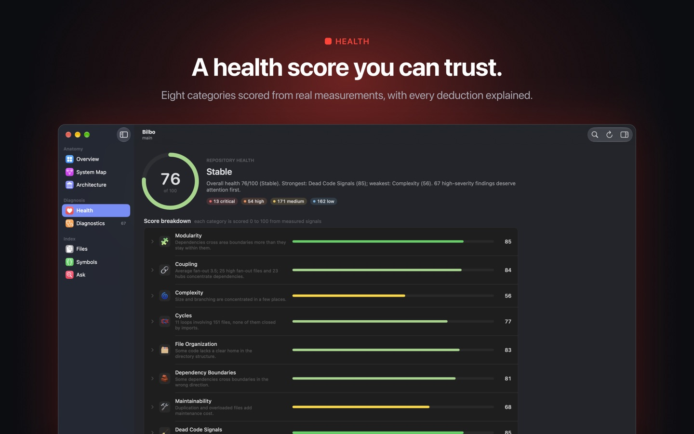
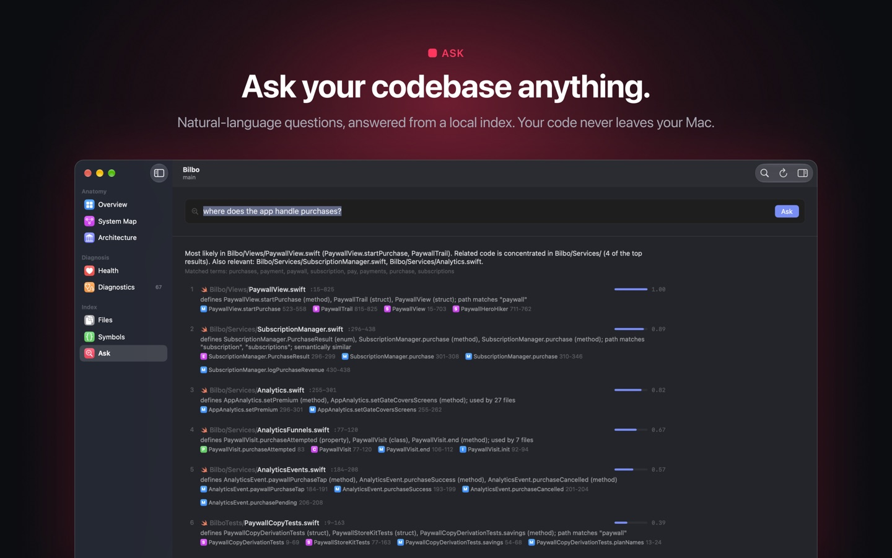
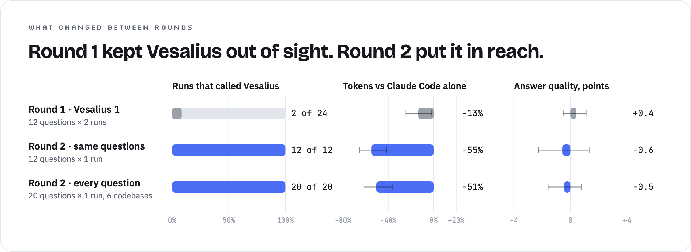
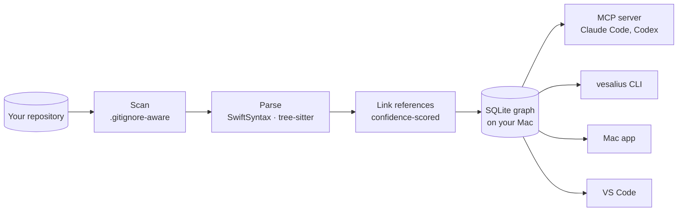

<picture>
  <source media="(prefers-color-scheme: dark)" srcset="docs/readme/banner-dark.png">
  
</picture>

<p align="center">
  <a href="#quick-start"><b>Quick start</b></a> &nbsp;·&nbsp;
  <a href="#the-five-tools-claude-gets">The five tools</a> &nbsp;·&nbsp;
  <a href="#the-mac-app">Mac app</a> &nbsp;·&nbsp;
  <a href="#vs-code">VS Code</a> &nbsp;·&nbsp;
  <a href="#does-it-actually-help">Benchmark</a> &nbsp;·&nbsp;
  <a href="#faq-and-troubleshooting">FAQ</a>
</p>

<p align="center">
  
  
  
  
  
  
</p>

When you ask an AI coding assistant about your project, something like *"what breaks if I change this?"*, it works
the way a new teammate would on their first day: search for a name, open a file, search again, open another file,
and slowly piece the answer together. Every one of those steps costs time and tokens, and on a real codebase they
add up fast. **Vesalius gives your assistant a map instead.** It reads your repository once, right on your Mac, and
remembers how everything connects: which file uses which, who calls what, where a feature actually lives. Then Claude
Code can ask it directly and get answers with exact file and line references, usually in one call instead of a chain
of searches. In our benchmark that cut the tokens Claude Code spent answering real questions about real codebases
roughly in half, and a blind AI judge scored the answers about the same. A map is useful to people too, so Vesalius
also comes as a Mac app and a VS Code extension for exploring code yourself. Vesalius itself never uploads your code.

<picture>
  <source media="(prefers-color-scheme: dark)" srcset="docs/readme/hero-dark.png">
  
</picture>

## Where it helps

- **Before a risky change.** "What breaks if I rename this?" lists the callers, including type-inferred uses a text
  search would miss, the files to edit and the tests to run, with a check on how complete that list is.
- **In a codebase you didn't write**, or wrote a year ago. See its shape, its health, its hotspots and where to start,
  before reading a single file.
- **When an agent does the digging.** Claude Code asks Vesalius first and greps far less, so it spends fewer tokens
  and fewer turns getting to an answer of about the same quality.
- **When you want the code to stay healthy.** A health score with every deduction explained, dependency cycles,
  oversized files, possibly unused code, each with its evidence.

## Quick start

**You need:** a Mac with Apple silicon that runs Xcode 26 (Vesalius targets macOS 15 and later; we test on macOS 27
with Xcode 26.6 and Swift 6.3), and git.
For the agent part, [Claude Code](https://docs.anthropic.com/en/docs/claude-code). For the editor part, VS Code 1.95
or later and Node 22 or later.

### 1. Build and install the `vesalius` command

```bash
git clone https://github.com/haplollc/Vesalius.git
cd Vesalius
scripts/install-cli.sh        # builds a release binary and installs it to ~/.local/bin
vesalius --version            # 2.0.0
```

The first build downloads SwiftSyntax and ArgumentParser (about 47 MB) and compiles SwiftSyntax in release mode, so it takes several minutes:
about 6 on an M2 in our runs, more on a busy machine. If `~/.local/bin` is not on your `PATH`, the script prints the
line to add to your shell profile. To install somewhere else, pass a folder: `scripts/install-cli.sh ~/bin`.

### 2. Index a project

```bash
cd ~/code/your-app
vesalius index
```

Here is Vesalius indexing its own repository:

```
Indexed ~/code/Vesalius
  files: 248 scanned · +248 added · ~0 changed · -0 removed · 0 unchanged
  graph: 9,157 symbols · 79,037 references · 2,611 dependency edges
  time:  5.97s · index ~/Library/Application Support/Vesalius/Indexes/vesalius-…/index.v4.sqlite
```

After that, every query re-reads only the files that changed (a refresh with nothing changed took 0.1 to 0.25 s in
our runs). You can also skip
this step: the first question from Claude Code builds the index on its own.

### 3. Connect Claude Code

```bash
claude mcp add --scope user vesalius -- vesalius mcp
```

That one line works in every project. Claude Code tells the server which folder it is working in, and Vesalius serves
that repository, indexing it the first time it is asked. Check it with `claude mcp list`:

```
vesalius: vesalius mcp - ✔ Connected
```

<details>
<summary><b>Other ways to register it</b> (team-shared, a full path, a pinned repository)</summary>

```bash
# Each of these replaces the registration from step 3, so remove that one first:
claude mcp remove --scope user vesalius

# Share it with your team through .mcp.json. Each person approves it once when they next start Claude Code;
# until then `claude mcp list` shows "⏸ Pending approval".
claude mcp add --scope project vesalius -- vesalius mcp

# If Claude Code cannot find `vesalius` on its PATH, give the full path
claude mcp add --scope user vesalius -- ~/.local/bin/vesalius mcp

# Always serve one repository, wherever Claude Code is started
claude mcp add --scope user vesalius -- vesalius mcp --repo ~/code/your-app

# Load every Vesalius tool on demand instead of two up front (see VESALIUS_MCP_PROFILE under Configuration)
claude mcp add --scope user vesalius -e VESALIUS_MCP_PROFILE=lean -- vesalius mcp
```

Any other MCP client that speaks stdio can run `vesalius mcp --repo /path/to/repo`. The Mac app's
**Settings › Agents** can register Vesalius with Claude Code and Codex for you, and copies an `mcpServers` JSON block
for other clients; add `"--repo", "/path/to/repo"` to its `args` unless your client starts servers in the project
folder.
</details>

### 4. Ask

Ask Claude Code the way you normally would. It picks the right tool on its own:

> *Who calls `SessionStore.save`, and what would I have to update if I renamed it?*<br>
> *Where are in-app purchases handled?*<br>
> *Are there any circular imports under src/?*<br>
> *What's in PaymentService.swift?*

Most answers come back in one call (long ones in pages), with file:line evidence, and `usages`, `feature_map` and
`dependency_cycles` also say how complete they are. Claude still opens or greps files when it wants to check
something, just far less: in our benchmark, 2.65 search, read and shell calls per question instead of 7.2.

## The five tools Claude gets

| Tool | Ask it… | What comes back |
|---|---|---|
| **`usages`** | *who calls X? what uses this file? what breaks if I rename X?* | Its uses as file:line + code, grouped by the function they sit in, including uses only type inference can see, minus same-name lookalikes, plus a completeness check. With `change: rename \| signature \| remove`: the edit list and the tests to run. |
| **`feature_map`** | *where are purchases handled? how is data persisted?* | The core types and functions grouped by role, with their decisive lines, framework and I/O calls, config and environment links, and call sites: a map that points straight at the right files and lines. |
| **`outline`** | *what's in this file, type or function?* | Declarations with signatures and line ranges, first doc sentences and calls in order, at about a fifth of the tokens of reading the file. |
| **`architecture`** | *how is this project put together?* | Targets and their product types, packages, folders, dependency direction, cycles and cross-target links, from the project files plus the code graph. |
| **`dependency_cycles`** | *do we have circular imports?* | Every cycle in scope with each edge's import line and where the imported names are used, plus what was scanned, so "no other cycles" needs no re-check. |

`usages` and `feature_map` are loaded up front, which adds about 900 tokens to Claude Code's context in every session
where Vesalius is registered (cached after the first request, and already counted in the benchmark totals). The
other three wait behind Claude Code's tool search until they are needed. Every tool is read-only.

This is exactly what Claude sees, because the command line prints the same text as the MCP tool:

```
$ vesalius usages RepositoryEngine.ensureFresh
@discardableResult public func RepositoryEngine.ensureFresh(options:progress:) async throw…  VesaliusKit/Sources/QueryEngine/RepositoryEngine.swift:201-210 · method · target QueryEngine
2 callers in 2 files (VesaliusCommands 1 · VesaliusMCP 1) · complete: "ensureFresh" occurs 9×: 2 resolved to the target, 1 declaration, 2 strings (DebugCommands.swift:21,76), 4 non-source (README.md); 0 unresolved
RepositoryEngine (owner type) is used by 56 other files
VesaliusKit/Sources/VesaliusCommands/VesaliusCommand.swift
  func GlobalOptions.engine() :70-81  "Opens the engine and brings the index up to date unless --no-refresh."
    77 │ if let summary = try await engine.ensureFresh(progress: { printer.update($0) })
    called by: runTool(_:_:full:) :95 · Watch.run() :254 · DebugCompleteness.run() DebugCommands.swift:31 · +22
VesaliusKit/Sources/VesaliusMCP/IndexCoordinator.swift
  private func IndexCoordinator.start(engine:force:) :88-105  "Starts a refresh off the actor (indexing must not hold up other calls' cache checks) and waits for…"
    96 │ let summary = force ? try await engine.index(options: options) : try await engine.ensureFresh…ptions: options)
    called by: prepare() :49 · reindexNow() :65
```

## Use it yourself

Everything Claude can ask, you can ask from a terminal. Add `--json` for scripts and `--repo <path>` to point at
another repository; every query refreshes the index first unless you pass `--no-refresh`.

| Command | What it answers |
|---|---|
| `vesalius usages <target>` | who calls, uses, imports or depends on a symbol, file, folder or module |
| `vesalius feature-map "<question>"` | where and how a feature is implemented |
| `vesalius outline <target>` | what a file, type, folder or function contains |
| `vesalius architecture --v2` | the project's targets, packages and layers |
| `vesalius dependency-cycles` | circular imports, optionally `--path src/` |
| `vesalius ask "<question>"` | ranked files, symbols and line ranges for a plain-English question |
| `vesalius impact <file or symbol>` | blast radius: dependents, call sites, tests and risk |
| `vesalius health` · `diagnostics` · `hotspots` · `unused` | the health score, its findings, the riskiest files, possibly dead code |
| `vesalius map` | the clustered dependency map, by modules, folders, files or symbols |
| `vesalius query "<sql>"` | read-only SQL against the index (`--schema` shows the tables) |
| `vesalius watch` | keep the index current while you work |

`vesalius --help` lists its 29 commands.

<details>
<summary><b>Real output: a type, a function, a feature, a question</b></summary>

All of these ran against Vesalius's own code. Long outputs are trimmed where marked.

```
$ vesalius usages IndexLocation
public struct IndexLocation: Sendable, Hashable  VesaliusKit/Sources/RepositoryIndex/IndexLocation.swift:29-152 · struct · target RepositoryIndex
13 uses in 6 files (Vesalius 1 · QueryEngine 1 · RepositoryIndex 1 · VesaliusCommands 1 · test 2); +2 files use it by type flow, never naming it; 32 member uses · complete: "IndexLocation" occurs 24×: 14 resolved to the target, 1 declaration, 2 comments (OutlineRenderer.swift:6,9), 7 non-source (README.md); 0 unresolved
Vesalius/App/AppModel.swift  via 172 │ return IndexLocation.allIndexed().filter { $0.exists && !known.contains($0.path) }
  canonicalRoot(_:) 69 (AppModel.handle)
[… 11 lines trimmed …]
Vesalius/Views/Settings/SettingsView.swift  via 101 │ let location = workspace.engine.location  [type-inferred via RepositorySettings.model → AppModel.workspace → Workspace.engine → RepositoryEngine.location: IndexLocation]
  directory 85 (RepositorySettings.body) · databaseURL 90 (RepositorySettings.body)
  removeIndex() 105 (RepositorySettings.body)
[… 7 lines trimmed …]
```

The `SettingsView.swift` line is the kind of use grep cannot find: the file never names `IndexLocation`, it reaches
it through four properties.

```
$ vesalius outline IndexingPipeline.run
func run(progress: @escaping @Sendable (IndexProgress) -> Void) async throws -> IndexSummary  VesaliusKit/Sources/QueryEngine/IndexingPipeline.swift:64-257 · in IndexingPipeline :30-450 · target QueryEngine · used by 2 files (1 app, 1 test)
flow IndexingPipeline.run(progress:)  VesaliusKit/Sources/QueryEngine/IndexingPipeline.swift:64-257
called by: RepositoryEngine.index(options:rebuild:progress:) VesaliusKit/Sources/QueryEngine/RepositoryEngine.swift:185
  72 │ let scan = try scanner.scan(isCancelled: { Task.isCancelled })  → RepositoryScanner.scan(isCancelled:) :201-203
  82 │ let directoryIDs = try store.syncDirectories(scan.directories)  → IndexStore.syncDirectories(_:) :153-173
  83 │ try store.setMeta("vendored_directories", VesaliusJSON.string(scan.vendoredDirectories))  → IndexStore.setMeta(_:_:) :106-108
  87 │ let stored = try store.storedFileStates()  → IndexStore.storedFileStates() :129-136
  111 │ try Task.checkCancellation()
  114 │ let prepared = try await prepare(batch, stored: reparseAll ? [:] : stored…tion: detection)  → IndexingPipeline.prepare(_:stored:detection:) :278-303
[… 18 lines trimmed …]
```

```
$ vesalius feature-map "how does incremental indexing work?"
feature: incremental, indexing
core  VesaliusKit/Sources/QueryEngine/IndexingPipeline.swift  public struct IndexOptions: Sendable :11-25
call sites: IndexOptions in 6 files (app 4, test 2) · complete: every file that names IndexOptions is listed
  Vesalius/App/Workspace.swift  reindex(initial:rebuild:)  185 │ options.scan.userExclusions = Preferences.exclusions(for: engine.root.path)
  VesaliusKit/Sources/QueryEngine/RepositoryEngine.swift  206 │ if try isOutdated || staleFileCount(options: options.scan) > 0
  VesaliusKit/Sources/VesaliusCommands/VesaliusCommand.swift  run()  206 │ options.scan.userExclusions = exclude
  VesaliusKit/Sources/VesaliusMCP/IndexCoordinator.swift  26 │ private let options: IndexOptions  ·34
[… 3 lines trimmed …]
```

```
$ vesalius ask "where does the app run Claude Code or Codex?" --limit 4
Most likely in Vesalius/Views/AgentSheet.swift (AgentSheet, AgentSheet.run). Related code is concentrated in Vesalius/App/ (3 of the top results). Also relevant: Vesalius/App/AgentSession.swift, Vesalius/App/Tooling.swift.

1. Vesalius/Views/AgentSheet.swift:6-200  [1.00]  defines AgentSheet (struct), AgentSheet.run (method), AgentConsole (struct); semantically similar
[… 9 lines trimmed …]
```

```
$ vesalius dependency-cycles
0 import cycles in the repository: scanned 201 files, 58 import edges, 0 unresolved; 30 test files excluded
Swift: 0 module import cycles among 13 modules (31 module dependencies from 240 import lines) · Swift files in one module see each other without imports; reference loops are not import cycles
no strongly connected component in scope
```

Each of these answered in under half a second.
</details>

## The Mac app

<table>
<tr>
<td width="50%"></td>
<td width="50%"></td>
</tr>
<tr>
<td><b>Overview.</b> Size, languages, health, architecture, a "start here" pick, hotspots and the files everything depends on.</td>
<td><b>System Map.</b> The clustered dependency graph. Select a file to light up what it uses and what uses it; cycles are dashed.</td>
</tr>
<tr>
<td width="50%"></td>
<td width="50%"></td>
</tr>
<tr>
<td><b>Health.</b> One score from eight categories, each deduction explained. Nothing is estimated by a language model.</td>
<td><b>Ask.</b> Plain-English questions, answered from the index with ranked files and the symbols that matched.</td>
</tr>
</table>

Open a repository with **⌘O** or by dropping a folder on the window. After the first index the app keeps itself up to
date as files change. Press **⌘K** for the command palette, **⇧⌘F** to ask a question, and select any file or symbol
to see its blast radius in the inspector. When a finding deserves a fix, **Improve with Claude Code or Codex…** writes
the prompt from the evidence, runs the agent in plan-only or edit mode, streams its transcript, then re-indexes and
shows the health score before and after.

**Build it:** open `Vesalius.xcodeproj` in Xcode 26, choose your own team under *Signing & Capabilities* for both the
Vesalius and VesaliusUITests targets (the project ships with ours), and run the **Vesalius** scheme. Copy the built app
to /Applications if you want the app's **Settings › Agents › Install for My User**, which links `~/.local/bin/vesalius`
to the app's own binary (replacing one from `install-cli.sh`) so the app and the command line share one index. Put
exclusions in a `.vesaliusignore` rather than the app's per-repository list, so Claude Code and the command line honour
them too.

## VS Code

The extension puts the same answers next to your code:

- **Health**, **Current File** and **Hotspots** views in the activity bar
- findings in the Problems panel, and a CodeLens with reference counts and change risk
- **Show Change Impact**, **Find References (Graph)**, **Find Callers** and **Ask the Codebase…** in the command palette
- a health score in the status bar, refreshed when you save
- on VS Code 1.101 and later, Vesalius registered as an MCP server for agent mode

Build and install it from this repository (it needs the `vesalius` command from step 1). The `code` command needs
VS Code's *Shell Command: Install 'code' command in PATH* once; otherwise install the `.vsix` from the Extensions view.

```bash
cd vscode-extension
npm ci
npm run package                                 # compiles and writes vesalius-1.0.0.vsix
code --install-extension vesalius-1.0.0.vsix    # or Extensions › ⋯ › Install from VSIX… in VS Code
```

## Does it actually help?

<picture>
  <source media="(prefers-color-scheme: dark)" srcset="docs/readme/rounds-dark.png">
  
</picture>

We asked headless Claude Code 20 real questions about 6 codebases, once with Vesalius attached and once without, on
one pinned build (2.1.307) with the same model, prompt and read-only tools. One AI judge then graded each answer
blind against a key verified in the code. With Vesalius, the typical question used **51% fewer tokens** (95% CI 36%
to 62% fewer; the geometric mean of per-question ratios, while plain means fell 44%, from 204k to 113k), took 43%
fewer turns and finished 41% sooner. Answer quality showed no measurable change overall (−0.5 points on a 0–100
scale, 95% CI −1.6 to +0.8, with both setups near 97–98), though answers about where a feature lives scored 2.1
points lower (95% CI −4.2 to −0.4). Eight questions were held out: written after Vesalius 2 was designed, on two
codebases whose questions and keys were never used to build it. On those it saved 44% (95% CI 12% to 65% fewer). The
other twelve are the ones it was built against.

The first version taught us the most. Claude Code keeps MCP tools out of sight until it searches for them, and it
almost never searched: round 1 used Vesalius in 2 of 24 runs, so that round's small token gap was mostly run-to-run
noise. Vesalius 2 answers each kind of question with one sharper tool and loads the two most-asked ones up front.
Claude used it in all 20 runs.

<details>
<summary><b>By kind of question, and where it did not win</b></summary>

| Kind of question | Questions | Tokens vs Claude Code alone | Quality (points) |
|---|---|---|---|
| Who depends on this file | 5 | −71% | +1.6 |
| Import cycles | 1 | −74% | +2.2 |
| Who calls this | 2 | −56% | −0.2 |
| What a change affects | 3 | −42% | −1.0 |
| Where a feature lives | 5 | −38% | −2.1 |
| Architecture | 2 | −33% | −1.2 |
| Where a symbol is used | 2 | −8% | −1.7 |

Vesalius used more tokens on 4 of the 20 questions (+2% to +19%). Quality moved by a point or more on 11 of them:
3 better and 8 worse. With one run and one judge per answer, single questions are noisy, which is why the intervals
above bootstrap over questions. The harness, the questions, the analysis and the full report are in
[`docs/benchmark`](docs/benchmark/README.md), so you can run the same comparison on your own code. An exact rerun
needs more than this repository: three of the six codebases are our own private apps, and the answer keys and run
transcripts stay private so they cannot leak into future tool designs or training data. The judge's instructions are
published in [`grading_prompt.md`](docs/benchmark/grading_prompt.md).
</details>

**[Read the full benchmark write-up](docs/benchmark/README.md)**: the setup, the six codebases, all 20 questions with
their numbers, exactly how answers were graded, and how to run it on your own code.

## Privacy

- **Vesalius never uploads your code.** It makes no network requests and has no accounts or telemetry. The only
  downloads are the build's own dependencies.
- **Vesalius never writes to your repository.** Indexes live in `~/Library/Application Support/Vesalius/Indexes`, or
  under `$VESALIUS_HOME` if you set it. Delete a folder there, or use **Settings › Repository › Delete Index…** in the
  app. The one exception is an agent run you start from the app in *Allow edits* mode, which edits your working tree;
  choose *Plan only* to keep it read-only.
- **Semantic search uses Apple's on-device model** (NaturalLanguage sentence embeddings). Nothing is downloaded.
- Vesalius's answers quote your code, and Claude Code sends what it reads, these answers included, to its model,
  exactly as it would after a grep. Agents started from the app use their own accounts the same way.

## Configuration

**Ignoring files.** Vesalius honours `.gitignore` at every level, `.git/info/exclude` and git's default global ignore
file (`~/.config/git/ignore`, or `$XDG_CONFIG_HOME/git/ignore`; a custom `core.excludesFile` is not read), and skips
build output, dependencies and vendored third-party code by default. For anything else, add a `.vesaliusignore`
(same syntax) at the root or in any folder. This is the one to use for lasting exclusions: `vesalius index --exclude`
applies to that run only.

| Variable | What it does |
|---|---|
| `VESALIUS_HOME` | Where indexes are stored (default `~/Library/Application Support/Vesalius`) |
| `VESALIUS_REPO` | The repository `vesalius mcp` serves, when you don't pass `--repo` |
| `VESALIUS_MCP_PROFILE` | `default` (`usages` and `feature_map` up front), `lean` (every tool on demand) or `full` (adds `repo_report`: health, diagnostics, hotspots, unused code) |
| `VESALIUS_TRACE` | Prints timing traces to stderr |

**Which repository the server picks:** `--repo`, then `$VESALIUS_REPO` (both used exactly as given), then the folder
Claude Code is working in (`$CLAUDE_PROJECT_DIR`), then the current directory. For those last two it serves the nearest
enclosing folder that already has an index, then the git root, then the folder itself. So starting Claude Code outside
any repository (your home folder, say) indexes that whole folder on the first question, and that index then wins for
every un-indexed project inside it; delete it from `Indexes` if that happens. The first line the server writes to
stderr names the repository it is serving.

## Languages

| Language | How it is read | What you get |
|---|---|---|
| **Swift** | full syntax tree (SwiftSyntax) | declarations, calls, type uses, inheritance, property wrappers, `#if` branches, environment variables; references resolved by receiver type, scope and module, each with a confidence score |
| **TypeScript, JavaScript** (incl. JSX/TSX) | tree-sitter | declarations, ES module and CommonJS imports and exports, references, `process.env` reads |
| **Python** | tree-sitter | classes, functions, imports, `__all__`, references, `os.environ` reads |
| Objective-C, C, C++, Go, Rust, Java, Kotlin, Ruby, PHP, C#, Dart, Shell, SQL | lexical | files, imports, declarations and type references (no call graph) |
| Markdown, JSON, YAML, HTML (including Vue and Svelte components), CSS and other text | full-text search | found by `ask` and `feature_map` |

## FAQ and troubleshooting

<details>
<summary><b>Claude Code doesn't seem to use it</b></summary>

Run `claude mcp list` and check that `vesalius` shows **✔ Connected**. A project-scoped registration shows
**⏸ Pending approval** until you start `claude` in that folder and approve it. Inside Claude Code, `/mcp` lists the
server and its tools. If it is connected but unused, ask for it by name once ("use vesalius to find who calls X").
</details>

<details>
<summary><b>It answered about the wrong folder</b></summary>

Started without `--repo`, the server serves the nearest enclosing folder that already has an index, then the git
root, then the folder itself, so an index on a parent folder (even your home folder) wins over a nested repository.
Pin it with `vesalius mcp --repo /path`, or set `VESALIUS_REPO`. The first line the server writes to stderr names the
repository it is serving.
</details>

<details>
<summary><b><code>error: … has not been indexed yet</code></b></summary>

You passed `--no-refresh` to a repository with no index. Run `vesalius index`, or drop `--no-refresh` and the query
will build the index first.
</details>

<details>
<summary><b>The VS Code extension can't find the command line tool</b></summary>

It looks at the `vesalius.cliPath` setting, then `VESALIUS_CLI_PATH`, then your `PATH`, `~/.local/bin`,
`/usr/local/bin` and `/opt/homebrew/bin`, then a Vesalius.app in /Applications or ~/Applications. Install it with
`scripts/install-cli.sh` or set `vesalius.cliPath`. If Vesalius.app is in /Applications, **Vesalius: Install Vesalius
CLI** in the command palette links it for you.
</details>

<details>
<summary><b>How accurate is it?</b></summary>

Swift references are resolved from types, scope and modules rather than by the compiler, so each link carries a
confidence and only confident ones become graph edges. That is why `usages` ends its summary line with a completeness
check: how many textual occurrences of the name resolved to the target, how many are declarations or non-source
mentions, and which, if any, it could not resolve, so Claude knows which sites are left to check. Uses that never
spell the name (reflection, selectors, dynamic dispatch) are outside that count. Health rules are heuristics that
show their evidence; "unused" means no references were found, which can miss reflection, Interface Builder and
dynamic dispatch.
</details>

<details>
<summary><b>How big and how fast?</b></summary>

From our runs on an M2: Vesalius's own 248 files index in about 3 s into a 25 MB database, and a refresh with nothing
changed takes a fraction of a second. The six benchmark codebases took 2.7 s to 20.5 s for a first index (longer on a
busy machine), the largest with 16,000 symbols and 143,000 references. Once the index is warm, most answers take tens of milliseconds and a
`feature_map` about a second.
</details>

## Under the hood



<details>
<summary><b>The packages, the pipeline, storage and search</b></summary>

```
VesaliusKit (Swift package, shared by app, CLI, MCP)
├── VesaliusCore        models, result types, tokenizer, concept lexicon, JSON
├── RepositoryScanner   .gitignore engine, default + vendored-project exclusions, git metadata, module detection
├── LanguageAnalysis    Swift (SwiftSyntax), TypeScript/JavaScript + Python (tree-sitter), lexical fallback
├── RepositoryIndex     SQLite (WAL) + FTS5 schema, import resolution, reference linking
├── GraphEngine         SCCs, PageRank, depth, reachability, Louvain clustering, risk and hotspot scores
├── HealthEngine        17 rules, 8-category score, architecture inference, extraction suggestions
├── SemanticSearch      query parsing, concept expansion, on-device NLEmbedding, hybrid ranking
├── QueryEngine         RepositoryEngine facade: incremental pipeline, file watcher, every query
├── VesaliusRender      plain-text rendering and token budgets, shared by the CLI and the MCP server
├── VesaliusMCP         MCP server (JSON-RPC over stdio): five tools, profiles, lazy single-flight indexing
├── VesaliusCommands    the `vesalius` CLI (ArgumentParser), also linked into the app binary
└── VesaliusCLI         standalone `vesalius` executable
Vesalius (macOS app)     SwiftUI + AppKit: map canvas, inspector, palette, agent console
```

**Indexing.** Scan (respecting `.gitignore` at every level, `.git/info/exclude`, global excludes, `.vesaliusignore`,
build and vendor folders and vendored third-party projects), compare size and modification time and then content
hash, parse changed files in parallel, write per-file batches transactionally, detect modules (SwiftPM targets, Xcode
targets, npm workspaces, tsconfig paths, Python packages), resolve imports, re-link only the references affected by
changed names, rebuild edges for affected files, then graph metrics, health, vocabulary and on-device semantic
vectors. One unreadable or unparsable file never stops the run.

**Storage.** `~/Library/Application Support/Vesalius/Indexes/<repo>-<hash>/index.v4.sqlite`, keyed by the canonical
repository path and named after the schema version, so older and newer builds keep separate files. The git root commit
is recorded, so a moved repository keeps its index.

**Search.** Each question becomes weighted terms: identifier splitting, stemming, a software-concept lexicon,
completions from the repository's own vocabulary, and Apple's on-device word embeddings. For every concept, Vesalius
takes the best of a direct or synonym match across FTS5 BM25 over files and symbols, path and type-name evidence and
sentence-embedding similarity, then adjusts for coverage of the question, structural centrality and one hop of graph
propagation. Structural questions go straight to the graph.

**References.** TypeScript, JavaScript and Python references resolve through explicit import bindings, including
barrel re-exports, namespace and default imports, relative imports and `__init__` packages. Swift has no per-file
imports, so references resolve by enclosing type, receiver type, module and name uniqueness, each with a confidence;
only links at 0.5 or above become graph edges.
</details>

## Development

```
Vesalius.xcodeproj         macOS app + UI tests (scheme: Vesalius)
Vesalius/                  app sources (SwiftUI + AppKit)
VesaliusUITests/           end-to-end UI tests
VesaliusKit/               Swift package: engine, CLI, MCP server, tests
vscode-extension/          VS Code extension
scripts/install-cli.sh     build and install the CLI
docs/benchmark/            the Claude Code benchmark: harness, questions, analysis, reports
docs/readme/               this README's images (make_images.py redraws the cards from the benchmark results; needs Chrome)
docs/brand/                the animated logo mark
.vesaliusignore            exclusions used when Vesalius analyses itself
```

```bash
(cd VesaliusKit && swift test)      # 298 tests, including end-to-end runs of the real binary over the CLI and MCP
xcodebuild test -project Vesalius.xcodeproj -scheme Vesalius -destination 'platform=macOS'
(cd vscode-extension && npm ci && npm test)   # a real VS Code against the CLI in VesaliusKit/.build (downloads VS Code once)
```

The UI tests launch the real app on a generated repository and drive it. macOS needs automation mode enabled once
for that: `sudo automationmodetool enable-automationmode-without-authentication`.

## License and credits

Copyright © 2026 Haplo, LLC. All rights reserved, except the VS Code extension in
[`vscode-extension`](vscode-extension), which is [MIT licensed](vscode-extension/LICENSE).

Vesalius builds on [tree-sitter](https://tree-sitter.github.io) and its TypeScript, JavaScript and Python grammars
(MIT, vendored with their licenses under `VesaliusKit/Sources/CTreeSitter*`, including tree-sitter's Unicode/ICU
notice), and on [swift-syntax](https://github.com/swiftlang/swift-syntax) and
[swift-argument-parser](https://github.com/apple/swift-argument-parser) (Apache 2.0).

It is named after Andreas Vesalius, whose *De humani corporis fabrica* (1543) mapped the human body from what he
could actually see. This tries to do the same for code.

<p align="center"><sub>Made by <a href="https://github.com/haplollc">Haplo</a></sub></p>
