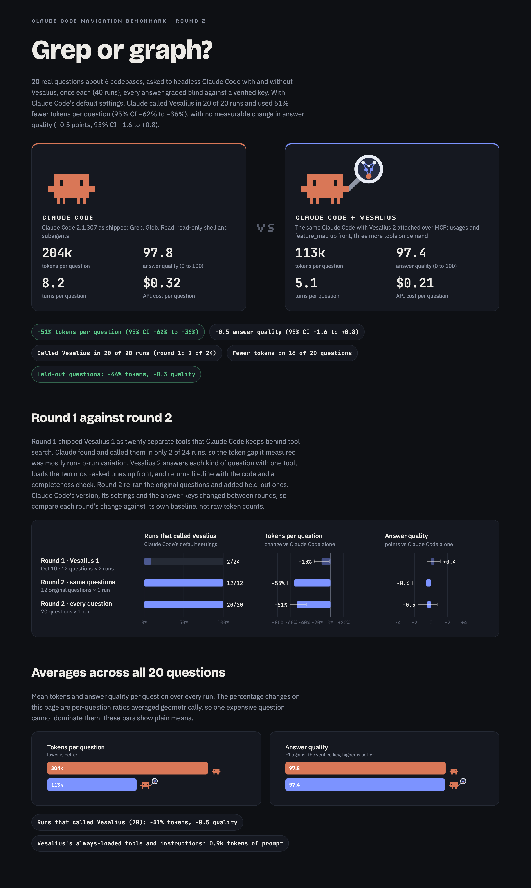

# Benchmark: Claude Code with and without Vesalius

This page explains how we measured what Vesalius does for Claude Code, the numbers behind
[the main README](../../README.md#does-it-actually-help). We asked headless Claude Code 20 real questions about 6
codebases, once with Vesalius attached and once without, and a judge graded every answer blind against an answer key
checked in the code. Below: how the runs were set up, what came out, how the answers were graded, what to keep in mind,
and how to run the same comparison on your own code. Round 2 results are in [`results.json`](results.json) and round 1
results in [`results_v1.json`](results_v1.json).

## In short

- **51% fewer tokens** for the typical question (95% CI 36% to 62% fewer). "Typical" is the geometric mean of the 20
  per-question ratios, so no single expensive question can dominate it. Plain means fell 44%, from 204k to 113k tokens
  per question.
- **43% fewer turns and 41% less time** for the typical question. On average a question took 5.1 turns instead of 8.2,
  and 29.0 seconds instead of 51.4.
- **Cost per question** averaged $0.21 with Vesalius and $0.32 without, by Claude Code's own estimate at API prices.
  The typical question cost 34% less.
- **No measurable change in answer quality.** 97.8 without Vesalius and 97.4 with, out of 100: a change of −0.5 points (95% CI −1.6
  to +0.8), so no measurable difference overall.
- **Claude chose Vesalius in 20 of 20 runs.** The questions never mention it.
- **Held-out questions**, written after Vesalius 2 was designed: 44% fewer tokens (95% CI 12% to 65% fewer), with
  quality −0.3 points.
- **One measurable weak spot:** questions about where a feature lives scored 2.1 points lower (95% CI −4.2 to −0.4).
- **Not a clean sweep:** Vesalius used more tokens on 4 of the 20 questions (+2% to +19%), and quality moved by a
  point or more on 11 of them, 3 better and 8 worse.

<p align="center">
  
</p>
<p align="center"><sub>The round 2 summary card, <code>report_share.png</code>. The whole report is
<a href="report.png"><code>report.png</code></a>, or <a href="report.html"><code>report.html</code></a> downloaded and
opened in a browser.</sub></p>

## How the runs were set up

Every question went to headless Claude Code twice, once in each setup. Everything except Vesalius was the same.

- **One pinned Claude Code.** Version 2.1.307, run from its versioned install path with auto-update turned off
  (`DISABLE_AUTOUPDATER=1`). The harness records the version before and after the whole batch of runs, and both said
  2.1.307. Model: `claude-opus-5-5`.
- **Without Vesalius** (`baseline_default` in the results): Claude Code as shipped, with its default tool search and
  no MCP servers.
- **With Vesalius** (`vesalius_deferred`): the same, plus the Vesalius 2.0.0 MCP server, serving the same repository
  copy from its own index folder. It ran its default profile: `usages` and `feature_map` are loaded up front, while
  `outline`, `architecture` and `dependency_cycles` wait behind Claude Code's tool search. The questions never mention
  Vesalius, so Claude decides on its own whether to call it.
- **The same prompt.** Each question, followed by this fixed suffix from [`tasks.json`](tasks.json):
  > Answer from the code in this repository. Be specific: give repository-relative file paths, and line numbers where
  > useful. Do not modify any files. In your final answer, report the findings only; do not describe which tools or
  > steps you used.
- **Read-only tools.** Both setups may use Read, Grep, Glob, LS, subagents (Task, Agent), TodoWrite and these shell
  commands: `grep`, `rg`, `find`, `ls`, `cat`, `head`, `tail`, `wc`, `sed -n`, `awk`, `sort`, `uniq`, `cut`, `tr`,
  `git grep`, `git log`, `git show` and `git ls-files`. The Vesalius setup may also call Vesalius. Edit, Write,
  MultiEdit, NotebookEdit, WebFetch and WebSearch are denied, and so is every shell command that writes, builds or
  launches something: `rm`, `mv`, `cp`, `mkdir`, `touch`, `chmod`, `git checkout`, `git restore`, `git reset`,
  `git pull`, `git stash`, `git commit`, `git clean`, `xcodebuild`, `swift`, `swiftc`, `npm`, `npx`, `open` and
  `xcrun`.
- **Project settings only.** `--setting-sources project`, plus `--strict-mcp-config` with a config written for each
  run, so neither setup picks up a developer's own permission grants or MCP servers, or a repository's auto-memory.
- **No leaks between setups.** In every run without Vesalius, the init record listed no Vesalius server or tools.
  `vesalius` isn't on the shell allowlist above, and none of those 20 transcripts ran it.
- **Frozen copies.** Each repository was an APFS clone made for the benchmark, so nobody's ongoing work could change
  the code under a run, and nothing a run did could reach the originals. The harness compares `git status` before and
  after the runs, and nothing had changed.
- **Interleaved order.** All runs were shuffled into one random order (with a fixed seed), so time of day and rate
  limits hit both setups alike.
- **One run per question per setup:** 20 questions × 2 setups = 40 runs.

What we measured, all from Claude Code's own report for each run:

- **Tokens:** input, output, cache reads and cache writes, summed over every model the run used, subagents included.
  Vesalius's tool definitions and instructions count too: the first prompt was 21,050 tokens with Vesalius and 20,147
  without (medians over runs), 903 more.
- **Turns, time and cost:** `num_turns`, `duration_ms` and `total_cost_usd`.
- **Quality** comes from the judge; see [How answers were graded](#how-answers-were-graded).

<details>
<summary><b>The exact command for each run</b></summary>

From [`run_benchmark.py`](run_benchmark.py), started in the repository copy with a 30-minute timeout:

```bash
claude -p "<question>

<suffix>" \
  --output-format stream-json --verbose --model claude-opus-5-5 \
  --setting-sources project --strict-mcp-config --mcp-config <this run's MCP config> \
  --allowedTools <the read-only tools above, plus mcp__vesalius with Vesalius> \
  --disallowedTools <the denied tools above> \
  --no-session-persistence --max-turns 80
```

The MCP config is `{"mcpServers": {}}` without Vesalius, and with it:

```json
{"mcpServers": {"vesalius": {"command": "<vesalius binary>", "args": ["mcp", "--repo", "<repository copy>"], "env": {"VESALIUS_HOME": "<index folder>"}}}}
```

</details>

## The six codebases

| Codebase | Language | Size | Symbols | Whose | Set |
|---|---|---|---:|---|---|
| Bilbo | Swift | 122k lines of Swift + 34k vendored C | 16,275 | Haplo's private app | original (B1 to B3) |
| cinder | Swift | 116k Swift + 34k vendored C | 15,835 | Haplo's private app | original (C1 to C3) |
| Wax | Swift | 34.5k Swift | 3,862 | open-source Swift package | original (W1 to W3) |
| itsyconnect-macos | TypeScript | 43k TypeScript | 2,006 | open-source TypeScript app | original (I1 to I3) |
| Haplo Invest | Swift | 81k Swift + 34k vendored C | 11,674 | Haplo's private app | held-out (H1 to H4) |
| Espresso | Swift | 47k Swift | 3,912 | open-source Swift package | held-out (E1 to E4) |

Three of the six are our own private apps, which is one reason nobody else can rerun this exactly. The other three
are open source.

## The questions

Twenty questions that a developer new to a codebase might ask an agent, of seven kinds: where a feature lives (5
questions), who depends on a file (5), what a change affects (3), who calls a function (2), where a symbol is used
(2), architecture (2) and import cycles (1). The full wording is in [`tasks.json`](tasks.json); the tables below
paraphrase them.

- **Original (12 questions)** on Bilbo, cinder, Wax and itsyconnect-macos. Round 1 used them, and so did the work on
  Vesalius 2: the golden checks in [`golden/`](golden) scored its tool output on these questions while it was built.
- **Held-out (8 questions)** on Haplo Invest and Espresso, written after Vesalius 2 was designed and never used to
  tune it. For each codebase, an agent was asked for three candidates per kind, written from the same templates as the
  original questions, and a hash picked one per kind, so nobody chose them by hand. Their answer keys were built
  without Vesalius. One caveat: while Vesalius 2 was being finished, two of its output rules were checked against the
  code of all six codebases, these two included. Their questions and answer keys were never seen.

## Results

### Overall

| | Without Vesalius | With Vesalius | Change |
|---|---:|---:|---|
| Tokens per question, mean | 204k | 113k | −51% typical (95% CI −62% to −36%), −44% in plain means |
| Tokens per question, median | 213k | 70k | |
| Turns per question, mean | 8.2 | 5.1 | −43% typical |
| Time per question, mean | 51.4 s | 29.0 s | −41% typical |
| Cost per question, mean | $0.32 | $0.21 | −34% typical |
| Answer quality, 0 to 100 | 97.8 | 97.4 | −0.5 points (95% CI −1.6 to +0.8) |
| Recall | 97.2 | 96.4 | |
| Precision | 98.6 | 98.4 | |
| Holistic score, 0 to 10, times ten | 87.3 | 85.3 | −2.0 points |
| Runs that called Vesalius | 0 of 20 | 20 of 20 | |
| First prompt, median tokens | 20,147 | 21,050 | +903 |

"Typical" is the geometric mean of the per-question ratios, with a 95% bootstrap interval over the questions. Vesalius
used fewer tokens on 16 of the 20 questions. With it, Claude made 2.65 search, read and shell calls per run instead of
7.2, plus 1.3 calls to Vesalius: `usages` 18 times across the 20 runs, `feature_map` 5, `architecture` 2,
`dependency_cycles` 1 and `outline` never.

### Original and held-out questions

| Questions | Count | Tokens, typical change | 95% CI | Quality, points | 95% CI | Fewer tokens on |
|---|---:|---:|---|---:|---|---|
| All | 20 | −51% | −62% to −36% | −0.5 | −1.6 to +0.8 | 16 of 20 |
| Original | 12 | −55% | −65% to −41% | −0.6 | −2.3 to +1.3 | 11 of 12 |
| Held-out | 8 | −44% | −65% to −12% | −0.3 | −1.3 to +0.9 | 5 of 8 |
| Held-out without H1 | 7 | −48% | −69% to −17% | −0.1 | −1.2 to +1.2 | 5 of 7 |

H1 asks about purchases and subscriptions, much like B1 in the original set, so the held-out set is also shown
without it.

### By kind of question

| Kind of question | Questions | Tokens, typical change | 95% CI | Quality, points | 95% CI |
|---|---:|---:|---|---:|---|
| Import cycles (cycles) | 1 | −74% | n/a | +2.2 | n/a |
| Who depends on this file (dependents) | 5 | −71% | −79% to −56% | +1.6 | −0.0 to +4.2 |
| Who calls this (callers) | 2 | −56% | −61% to −49% | −0.2 | −0.3 to 0.0 |
| What a change affects (change impact) | 3 | −42% | −71% to +17% | −1.0 | −4.7 to +3.0 |
| Where a feature lives (feature location) | 5 | −38% | −57% to −13% | −2.1 | −4.2 to −0.4 |
| Architecture (architecture) | 2 | −33% | −63% to +19% | −1.2 | −2.0 to −0.3 |
| Where a symbol is used (symbol usage) | 2 | −8% | −20% to +7% | −1.7 | −2.0 to −1.4 |

With only two questions, a bootstrap interval is just the range between them, so the two-question rows say little.
Where a feature lives is the one kind with enough questions to show a drop: 2.1 points lower (95% CI −4.2 to −0.4).
Three of its five questions dropped (B1 by 6.2 points, W2 by 2.4 and H1 by 1.8) and two did not move. On average the
answers with Vesalius found fewer of the required items (recall −2.6 points) and got more of their claims wrong
(precision −1.4). Architecture and symbol-usage answers also scored lower on both of their questions, by 0.3 and 2.0
points and by 1.4 and 2.0 points, but two questions are too few to call that a pattern. Where a symbol is used is also
where Vesalius saved the least: 8% fewer tokens, while its cost went up 25% for the typical question.

### Question by question

Tokens in thousands, the change in tokens for that question, and quality as the judge's score out of 100. Each number
is a single run, so single rows are noisy.

**Original questions**

| ID | Codebase | Kind | Question, in short | Tokens without | Tokens with | Change | Quality without | Quality with |
|---|---|---|---|---:|---:|---:|---:|---:|
| B1 | Bilbo | feature location | Where in-app purchases and subscriptions are handled | 213k | 76k | −64% | 98.0 | 91.8 |
| B2 | Bilbo | change impact | What renaming `SubscriptionManager.isSubscribed` touches | 166k | 49k | −71% | 100.0 | 98.9 |
| B3 | Bilbo | callers | Who calls `TripPlanningService.importTrip` | 86k | 44k | −49% | 100.0 | 100.0 |
| C1 | cinder | symbol usage | Every file that uses `SettingsManager`, watch app included | 84k | 67k | −20% | 100.0 | 98.6 |
| C2 | cinder | architecture | Architecture overview: targets, packages, layers | 486k | 181k | −63% | 94.0 | 93.8 |
| C3 | cinder | dependents | Files that depend on the workout plan scheduler | 223k | 46k | −79% | 97.4 | 97.4 |
| W1 | Wax | change impact | What changing `MiniLMEmbedder.embed(_:)` would affect | 312k | 364k | +17% | 98.9 | 94.2 |
| W2 | Wax | feature location | How data is written to disk: file format and commit path | 219k | 151k | −31% | 96.5 | 94.1 |
| W3 | Wax | dependents | Files that depend on the WAL record types | 122k | 52k | −58% | 93.0 | 100.0 |
| I1 | itsyconnect-macos | cycles | Circular imports between modules | 338k | 89k | −74% | 97.8 | 100.0 |
| I2 | itsyconnect-macos | dependents | Files that import the encryption module, and why | 121k | 70k | −42% | 100.0 | 100.0 |
| I3 | itsyconnect-macos | feature location | Where App Store Connect API credentials are stored and protected | 257k | 107k | −58% | 100.0 | 100.0 |

**Held-out questions**

| ID | Codebase | Kind | Question, in short | Tokens without | Tokens with | Change | Quality without | Quality with |
|---|---|---|---|---:|---:|---:|---:|---:|
| H1 | Haplo Invest | feature location | Subscription products, access rules, paywall, purchases and restores | 268k | 273k | +2% | 97.8 | 96.1 |
| H2 | Haplo Invest | callers | Who calls `ModelDownloadManager.downloadedModels` | 173k | 66k | −61% | 98.3 | 98.0 |
| H3 | Haplo Invest | change impact | What changing `stockPreviewAction(_:_:)` would affect | 119k | 69k | −42% | 97.0 | 100.0 |
| H4 | Haplo Invest | dependents | Files that depend on the daily trade series code | 218k | 45k | −79% | 100.0 | 100.0 |
| E1 | Espresso | feature location | How local benchmark artifacts are built from a text corpus | 188k | 158k | −16% | 98.2 | 98.2 |
| E2 | Espresso | symbol usage | Every file that uses `DirectTokenSelectingLanguageModel` | 40k | 43k | +7% | 96.8 | 94.8 |
| E3 | Espresso | dependents | Files that depend on the decode forward pass | 214k | 44k | −80% | 99.1 | 100.0 |
| E4 | Espresso | architecture | Architecture overview: targets, layers, dependencies | 231k | 274k | +19% | 93.9 | 91.9 |

## How answers were graded

### Answer keys

Every question has an answer key, built from the code before any grading. Claude agents built them in a Claude Code
workflow, in three steps:

1. **Two independent investigators** answered the question from the code. Each listed every item of the answer (a
   file, a caller with its file and line, a type or function, a cycle, a fact) with file:line evidence and a short
   quote, plus plausible claims that would be wrong.
2. **A reconciler** merged the two lists. An item that only one investigator found, or that they disagreed on, stayed
   only if the reconciler confirmed it by reading the code. Items they agreed on were spot-checked.
3. **An adversarial challenger** re-derived the answer on its own, then tried to refute the draft: wrong or unsupported
   items, missing items, weights that were off, and "incorrect" entries that were actually right. It fixed what it
   could prove with file:line evidence and logged every change.

[`extract_keys.py`](extract_keys.py) collects those challenged keys into `answer_keys.json`. For the 12 original
questions, one investigator used only text search and reading, and the other could use the Vesalius 1 command line to
find candidates but had to confirm each one by reading the code. For the 8 held-out questions, nobody used Vesalius or
any code index: one investigator searched the text exhaustively, and the other traced types by reading, to catch uses
that never spell the name.

Each key holds what the judge sees:

- a short summary of the right answer;
- **required items**, each with an id, the item, its kind, its evidence and a weight: 2 for central items such as the
  main files, types or callers, and 1 for the rest;
- **acceptable items**: true but optional, so mentioning them is fine and leaving them out costs nothing;
- **known incorrect claims**, each with the reason it is wrong;
- **grading notes**, such as which spellings of a name count;
- and the challenger's list of changes.

Some of the original keys were corrected between round 1 and round 2. The keys and the run transcripts stay private,
so they cannot leak into future tool designs or training data.

### Blind judging

[`prep_grading.py`](prep_grading.py) builds one panel per question and judge: the question, its key and every answer
to that question (here two, one per setup), in a different random order for each judge.

- **Anonymous ids.** Answers get ids like A001, handed out after shuffling all the runs. Which id came from which
  setup is kept in a separate `blind_map.json` that the judge never sees.
- **Masked tool names.** Its `neutral()` function rewrites wording that would give the setup away, in the answers and
  in the key alike. "Vesalius", "code index", the twenty tool names of Vesalius 1 and the tool syntax of Vesalius 2
  (`mcp__vesalius__…`, `feature_map`, `dependency_cycles`, `usages(…)` and the like) all become "the search". The
  prompt suffix also asks Claude to report findings only, not the tools it used.
- **Checked in the code.** The judge can read the repository, and is told to check any claim the key does not cover
  in the code before calling it right or wrong.
- **One judge per answer in round 2:** a Claude agent running `claude-opus-5-5`, the same model that wrote the
  answers. Round 1 used three judges per answer.

The exact prompt and the format of the grades are in [grading_prompt.md](grading_prompt.md).

### The score

For each answer, [`analyze.py`](analyze.py) turns the judge's grade into a quality score from 0 to 100:

- **Recall** is the weighted share of the key's required items that the answer contains. Central items weigh 2 and the
  rest 1, so missing a main file costs twice as much as missing a minor one.
- **Precision** is the share of the answer's concrete claims that are correct. A claim is any file, symbol, caller,
  dependency, cycle, line reference or technical fact the answer asserts. It counts as wrong if the key or the code
  contradicts it, if the key lists it as incorrect, or if it does not exist, which includes line numbers more than
  about 10 lines off.
- **Quality** is 100 × F1, where F1 = 2 × recall × precision ÷ (recall + precision).
- The judge also gives a **holistic** score from 0 to 10 for how useful and trustworthy the answer is. It is reported
  as `usefulness` in results.json (times ten) but is not part of quality.

An answer's quality is the mean over its judges, and a question's is the mean over its runs; with one judge and one
run here, each is a single grade. Changes between the setups are worked out per question and then combined: tokens,
turns, time and cost as the geometric mean of the per-question ratios, and quality as the mean of the per-question
differences. The 95% intervals come from 4,000 bootstrap resamples of the questions. "Better" or "worse" means a
change of a point or more.

## Round 1 and round 2

<picture>
  <source media="(prefers-color-scheme: dark)" srcset="../readme/rounds-dark.png">
  
</picture>

Round 1 tested Vesalius 1, which gave Claude twenty separate tools. Claude Code keeps MCP tools behind its tool search
until Claude goes looking for them, and Claude almost never did: over 12 questions × 2 runs it called Vesalius in 2 of
24 runs. So the 13% token gap that round measured (95% CI 2% to 24% fewer) says little about Vesalius; it was mostly
run-to-run noise. Round 1 also ran a second pair of setups with every tool definition loaded up front. There Claude
called Vesalius 1 in 12 of 24 runs, and tokens still did not move measurably (+3%, 95% CI 19% fewer to 26% more).

Vesalius 2 answers each kind of question with one sharper tool, five in all, and loads the two most-asked ones,
`usages` and `feature_map`, up front. Round 2 re-ran the 12 original questions, added the 8 held-out ones and dropped
the second pair. Claude called Vesalius in all 20 runs.

Claude Code's version and settings changed between the rounds. Round 2, for example, also allowed `awk`, `sort`,
`uniq`, `cut`, `tr`, `git show` and `git ls-files`, because in round 1 denying them had cost runs without Vesalius an
extra request. Some answer keys were corrected too. So compare each round's change against its own baseline, not raw
token counts across rounds.

## What to keep in mind

- **A small sample.** 20 questions, one run per setup. Single questions swing by several points (B1 −6.2, W3 +7.0),
  which is why every interval resamples whole questions. Read the per-question rows as noisy.
- **One judge.** Round 2 had one judge per answer, and it was the same model that wrote the answers. It never saw
  which setup wrote what or which tools were used, but another judge could score differently. Round 1 used three.
- **Quality near the ceiling.** Both setups averaged between 97 and 98 out of 100, so the score has little room to show
  a gain, and tokens carry most of the signal. Drops still show, as the feature-location result does.
- **The original questions shaped Vesalius 2.** The held-out set guards against that, but it is 8 questions on 2
  codebases, and H1 is close to B1. Without H1, held-out tokens fell 48%.
- **Keys and Vesalius 1.** On the 12 original questions, one of the two investigators building each key could use the
  Vesalius 1 command line to find candidates, each confirmed in the code. That could tilt those keys toward what
  Vesalius finds. The held-out keys were built without it.
- **No exact rerun.** Bilbo, cinder and Haplo Invest are our private apps, and the answer keys and transcripts stay
  private. Claude Code and its models also change over time. The harness is all here, so you can run the same
  comparison on your own code.
- **Rounds differ.** Claude Code's version, its settings and some answer keys changed between round 1 and round 2.
- **One agent, one model.** Everything here is Claude Code with `claude-opus-5-5`. Other agents and models may behave
  differently.
- **Cost is an estimate.** It is Claude Code's own figure at API prices.

## Run it on your own code

You need macOS, Python 3 (the scripts use only its standard library), Claude Code, and the `vesalius` command from the
main README's [Quick start](../../README.md#quick-start). Every run is a real Claude Code session on your account.

**1. Copy the harness and freeze your code.** The scripts read `tasks.json` from their own folder, so work in a copy.
From your Vesalius checkout:

```bash
mkdir -p ~/bench/repos
cp -R docs/benchmark ~/bench/harness
cp -c -R ~/code/your-app ~/bench/repos/your-app    # -c makes an APFS clone: fast, and it keeps .git
```

Each copy should be a git repository: the harness records its commit and compares `git status` before and after.

**2. Write your questions** in `~/bench/harness/tasks.json`. Keep the `suffix` and replace the `tasks` with your own,
in the same shape as ours:

```json
{"id": "Q1", "repo": "your-app", "type": "callers", "set": "original",
 "prompt": "Which functions call `PaymentService.charge`? List each caller with its file and line."}
```

`repo` is a folder name under `--repos`, `type` groups the results by kind of question, and `set` is `original` or
`heldout` (for questions written after you tuned anything). Our 20 questions make good templates.

**3. Run both setups.** Point `--claude` at one installed version (`ls ~/.local/share/claude/versions`) rather than
the `claude` on your PATH, which can update itself in the middle of a run.

```bash
python3 ~/bench/harness/run_benchmark.py \
  --vesalius ~/.local/bin/vesalius \
  --home ~/bench/vesalius-home \
  --repos ~/bench/repos \
  --claude ~/.local/share/claude/versions/<version> \
  --arms baseline_default,vesalius_deferred \
  --reps 1 \
  --out ~/bench/run
```

`--arms` and `--reps` match our round 2. The defaults are `baseline,vesalius,vesalius_deferred` and 2 runs each, where
`baseline` and `vesalius` are round 1's second pair, with every tool definition loaded up front. `--jobs` (default 6)
sets how many runs go at once, `--only Q1,Q2` and `--sets heldout` pick questions, and finished runs are reused unless
you pass `--force`. Everything lands in `~/bench/run`:

- `setup.json`: the Claude Code and Vesalius versions, the model, the arms and each repository's commit;
- `runs.json`: every run's tokens, turns, time, cost, tool calls and answer;
- `transcripts/`: each run's stream-json transcript, named like `Q1__vesalius_deferred__r1.jsonl`;
- `mcp/`: the MCP config each run used.

Vesalius indexes each copy into `--home` the first time it is asked. If you do not want that first question to include
indexing time, index the copies beforehand:
`VESALIUS_HOME=$HOME/bench/vesalius-home vesalius index ~/bench/repos/your-app`.

**4. Write the answer keys** in `~/bench/answer_keys.json`, one per question, ideally before you read any answers.
[Answer keys](#answer-keys) describes how we built ours. analyze.py only needs `task` and the `id` and `weight` of each
required item, but the judge sees the whole key:

```json
[
  {
    "task": "Q1",
    "summary": "The right answer in a few sentences.",
    "required": [
      {"id": "Q1-1", "item": "a central caller, file or fact", "kind": "caller", "evidence": "file:line and a short quote", "weight": 2},
      {"id": "Q1-2", "item": "a less central one", "kind": "caller", "evidence": "file:line and a short quote", "weight": 1}
    ],
    "acceptable": [{"item": "something true but optional", "why": "why it may be mentioned"}],
    "incorrect": [{"claim": "a plausible wrong claim", "why": "why it is wrong"}],
    "grading_notes": "which spellings of a name count, and similar",
    "changes": []
  }
]
```

If you build keys with a Claude Code workflow whose final agents are labelled `challenge:<question id>`, as ours were,
`python3 ~/bench/harness/extract_keys.py <workflow journal.jsonl> ~/bench/answer_keys.json` collects them.

**5. Build the blind panels.**

```bash
python3 ~/bench/harness/prep_grading.py \
  --runs ~/bench/run/runs.json \
  --keys ~/bench/answer_keys.json \
  --repos ~/bench/repos \
  --judges 1 \
  --out ~/bench/panels \
  --map ~/bench/blind_map.json
```

This writes one panel per question and judge (such as `~/bench/panels/Q1-judge1.json`), the list of panels
(`panels-<question ids>.json`), and `blind_map.json`, which records which anonymous id came from which setup. Keep the
map away from the judge. `--judges` defaults to 3; round 2 used 1. If the map file already exists, its ids are reused.

**6. Grade.** Give each panel to a judge with the prompt in [grading_prompt.md](grading_prompt.md), filling in its
placeholders from the panel list. Any model or agent that can read the repository and reply in that format will do.
Save the grades in `~/bench/grades.json`, keyed by answer id, with one entry per judge:

```text
{"A001": [<judge 1's grade for A001>, ...], "A002": [...], ...}
```

If you grade with a Claude Code workflow that labels each judge `judge:<question id>-<judge number>`, as ours did,
`python3 ~/bench/harness/extract_grades.py ~/bench/grades.json <workflow journal.jsonl> [more journals]` builds that
file for you. Note that the output file comes first here.

**7. Analyze.**

```bash
python3 ~/bench/harness/analyze.py \
  --runs ~/bench/run/runs.json \
  --grades ~/bench/grades.json \
  --map ~/bench/blind_map.json \
  --keys ~/bench/answer_keys.json \
  --transcripts ~/bench/run/transcripts \
  --out ~/bench/results.json
```

`~/bench/results.json` has the same shape as ours: one row per question, a summary per setup, and the comparisons
overall, per set and per kind of question, with their intervals.

**8. Make the report** (optional).

```bash
python3 ~/bench/harness/make_report.py \
  --results ~/bench/results.json \
  --runs ~/bench/run/runs.json \
  --setup ~/bench/run/setup.json \
  --out ~/bench \
  --png
```

This writes `~/bench/report.html`. With `--png` it also renders `report.png` and `report_share.png` through Google
Chrome, which it expects in /Applications. The page is built around our study: it compares `baseline_default` with
`vesalius_deferred`, always shows our round 1 from `results_v1.json` (another file with `--v1`), and a few labels
name our codebases. Without `--out` it writes into the harness folder.

Two helpers are handy along the way:

- `python3 ~/bench/harness/transcript_view.py ~/bench/run/transcripts/Q1__vesalius_deferred__r1.jsonl` prints one
  run as a numbered timeline of tool calls, results and text.
- `python3 ~/bench/harness/mcp_client.py --vesalius ~/.local/bin/vesalius --repo ~/bench/repos/your-app list` (or
  `call usages '{"target": "PaymentService.charge"}'` in place of `list`) talks to `vesalius mcp` the way Claude Code
  does, so you can see exactly what Claude gets.

## Files in this folder

- [`README.md`](README.md): this page.
- [`grading_prompt.md`](grading_prompt.md): the judge prompt and the format of its grades.
- [`tasks.json`](tasks.json): the 20 questions with their codebase, kind and set, and the suffix added to each.
- [`run_benchmark.py`](run_benchmark.py): runs each question through headless Claude Code in each setup and records
  tokens, turns, time, cost, tool calls and answers.
- [`prep_grading.py`](prep_grading.py): builds the blind grading panels and the map from anonymous ids to setups.
- [`extract_keys.py`](extract_keys.py): collects the final answer keys from a Claude Code workflow journal.
- [`extract_grades.py`](extract_grades.py): collects judge grades from workflow journals into `grades.json`.
- [`analyze.py`](analyze.py): turns runs and grades into `results.json`, with scores, ratios and bootstrap intervals.
- [`make_report.py`](make_report.py): renders `report.html`, and with `--png` the two report images.
- [`report_template.html`](report_template.html): the page make_report.py fills in.
- [`report.html`](report.html): the round 2 report; download it and open it in a browser.
- [`report.png`](report.png): the whole round 2 report as one image.
- [`report_share.png`](report_share.png): the round 2 summary card shown above.
- [`results.json`](results.json): round 2 results.
- [`results_v1.json`](results_v1.json): round 1 results: four setups, 12 questions, 2 runs each.
- [`mcp_client.py`](mcp_client.py): a minimal MCP client that drives `vesalius mcp` the way Claude Code does.
- [`transcript_view.py`](transcript_view.py): prints one run's transcript as a numbered timeline.
- [`golden/golden_check.py`](golden/golden_check.py): the checks that scored Vesalius 2's tool output on the 12
  original questions while it was built. Its expectations are private, so it will not run as is.
- [`golden/plan.json`](golden/plan.json): the planned Vesalius call for each original question, used by
  golden_check.py.
